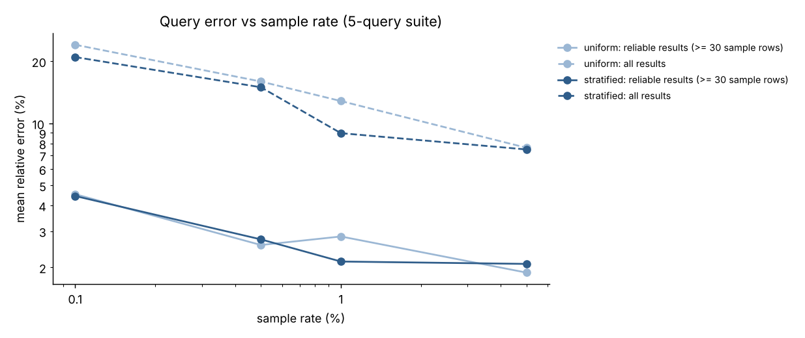

# TrendForge: Approximate Query Engine

TrendForge answers SQL aggregate queries on CSV files that are too big for memory.
It streams the file once to build a small random sample, then answers queries from the
sample in milliseconds, **with a 95% confidence interval on every number**. When you need
the exact answer, it streams the full file in 1M-row chunks with flat memory use.

```
SELECT AVG(price), COUNT(*) FROM orders WHERE discount > 0 GROUP BY region
```

| | Exact (full scan) | Approximate (1% sample) |
|---|---|---|
| 100M rows / 5.3 GB | ~40 s per query | ~0.2 s per query |
| Answer | exact | estimate ± 95% CI |

## Results (100M rows, 5.29 GB CSV, 2-vCPU machine)

- **Faster workloads:** a 5-query workload (including the one-off sampling pass) runs
  **3.3x faster** with stratified sampling (4.5x uniform). After the sample is built,
  each query is **39-1,400x faster** than a full scan, depending on sample size.
- **Error controlled by one parameter, the sample rate.** For `AVG(price) GROUP BY region`,
  mean error falls from **1.78% at a 0.1% sample to 0.12% at a 5% sample** (uniform).
  Across all 5 test queries (well-supported results), error drops from 4.5% to 1.9%.
- **Memory:** streaming keeps memory flat (1M-row chunks, only needed columns parsed).
  Peak was ~1.1 GB for the whole benchmark, most of it the 5M-row sample.
  Text columns are stored as `category`: a 1M-row sample takes 35 MB.

Full tables: [`benchmarks/results_100m/results.md`](benchmarks/results_100m/results.md)
(single run) and [`benchmarks/results_10m/results.md`](benchmarks/results_10m/results.md)
(10M rows, averaged over 3 seeds).



**What I learned from the benchmarks:** error depends on the *number* of sampled rows,
not the *fraction*. With ~500k sampled rows, Q1's error is about the same whether that is
5% of 10M rows (0.61%) or 0.5% of 100M rows (0.45%). So as data grows, the same accuracy
needs a smaller fraction, and sampling pays off more.

## How it works

```
SQL ─▶ parser ─┬─▶ exact engine ── streams every chunk, merges partial aggregates
               └─▶ estimators ◀── sample ◀── one streaming pass (uniform or stratified)
```

1. **Streaming reader** (`stream.py`): `pandas.read_csv(chunksize=1_000_000, usecols=…)`.
2. **Exact engine** (`exact.py`): per-chunk partial `sum`/`count` per group, merged at
   the end. AVG = total sum / total count.
3. **Sampling** (`sampler.py`), one pass over the file:
   - *Uniform*: keep each row with probability `rate`.
   - *Hybrid stratified*: per stratum (e.g. region), a Bernoulli sample at `rate` **plus**
     a reservoir sample (Algorithm R) of `min_rows` rows. Strata whose Bernoulli sample is
     too small use the reservoir instead, so rare groups are never missing. Stratum sizes
     are counted exactly. Supports composite strata (`["region", "category"]`).
4. **Estimators** (`estimators.py`): stratified estimators for COUNT/SUM, ratio
   estimator for AVG, variance with finite-population correction → 95% CI. Each result
   also reports `sample_rows`; below 30 the CI is flagged as unreliable.
5. **Front ends**: Streamlit app (`app/streamlit_app.py`) and a CLI (`trendforge/cli.py`).

More detail and the maths: [`docs/design.md`](docs/design.md).

## Supported SQL

```
SELECT COUNT(*) | SUM(col) | AVG(col) [, ...] [, group_col]
FROM table
[WHERE col <op> value [AND ...]]      -- op: = != < <= > >=, strings in 'quotes'
[GROUP BY group_col]
```

## Quick start

```bash
pip install -r requirements.txt

# 1. data (synthetic e-commerce orders, skewed on purpose)
python scripts/generate_data.py --rows 10_000_000 --out data/orders_10m.csv

# 2. web UI
streamlit run app/streamlit_app.py

# 3. or the CLI
python -m trendforge.cli sample data/orders_10m.csv --rate 0.01 --strata region --out data/orders.sample
python -m trendforge.cli query data/orders_10m.csv \
    "SELECT AVG(price) FROM orders GROUP BY region" --sample data/orders.sample
python -m trendforge.cli query data/orders_10m.csv \
    "SELECT AVG(price) FROM orders GROUP BY region" --exact

# 4. or from Python
python -c "
from trendforge import Engine
tf = Engine(); tf.register('orders', 'data/orders_10m.csv')
tf.build_sample('orders', rate=0.01, strata='region')
print(tf.query('SELECT SUM(revenue) FROM orders GROUP BY region'))"

# tests and benchmarks
python -m pytest tests
python benchmarks/run_benchmark.py --data data/orders_10m.csv --repeats 3 --out benchmarks/results_10m
```

## Project structure

```
trendforge/
├── trendforge/
│   ├── query.py        # SQL subset parser
│   ├── stream.py       # chunked CSV reader, WHERE evaluation
│   ├── exact.py        # exact streaming aggregation
│   ├── sampler.py      # uniform + hybrid stratified sampling (reservoir)
│   ├── estimators.py   # estimates + confidence intervals
│   ├── engine.py       # public API
│   └── cli.py
├── app/streamlit_app.py
├── scripts/generate_data.py
├── benchmarks/         # run_benchmark.py + results for 10M and 100M rows
├── tests/              # 24 pytest tests
└── docs/design.md
```

## Limitations
- Very selective filters on rare groups (e.g. `price > 100` within a rare category) leave
  few matching sample rows. Error stays high (Q4 in the benchmark) and the engine warns.
- Confidence intervals use a normal approximation; for groups with < 30 sample rows on
  skewed columns they are too narrow (measured coverage 73-88% vs 93-94% for groups with 100+ sample rows).
- No joins, ORDER BY or expressions inside aggregates; one GROUP BY column.
- CSV parsing is the bottleneck. Parquet input would make the sampling pass much faster.
