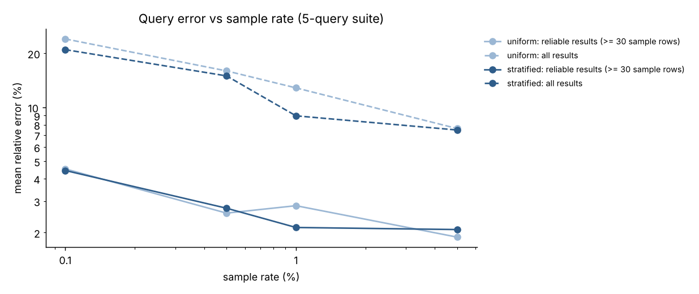

# Benchmark results

- Data: `orders_100m.csv`: 100,000,000 rows, 5.29 GB
- Machine: Linux x86_64 (2 vCPU, 8 GB RAM), Python 3.13.18, chunk size 1,000,000 rows
- Stratified sampling on: region (min 2,000 rows per stratum)
- Each setting averaged over 1 sample(s) with different random seeds
- Peak process memory during the whole benchmark: **1,113 MB**
- Exact workload (5 queries, each a full streaming scan): **195.8s**

## Queries

- **Q1**: `SELECT AVG(price) FROM orders GROUP BY region` (exact: 44.31s)
- **Q2**: `SELECT SUM(revenue), COUNT(*) FROM orders WHERE discount > 0 GROUP BY region` (exact: 37.23s)
- **Q3**: `SELECT AVG(revenue) FROM orders WHERE category = 'C03' GROUP BY region` (exact: 41.26s)
- **Q4**: `SELECT COUNT(*), AVG(quantity) FROM orders WHERE price > 100 GROUP BY category` (exact: 34.59s)
- **Q5**: `SELECT SUM(revenue) FROM orders WHERE region = 'Oceania' AND quantity >= 3` (exact: 38.41s)

## Accuracy and speed by sample rate

- **error % (reliable)**: mean relative error over results backed by >= 30 sample rows (the engine flags the others)
- **error % (all)**: every result cell; groups missing from the sample count as 100%
- **query speedup**: exact workload time / approximate query time, sample already built
- **workload speedup**: same, but including the one-off sample build pass

| method | rate | sample rows | error % (reliable) | error % (all) | CI coverage % | build s | 5 queries s | query speedup | workload speedup |
|---|---|---|---|---|---|---|---|---|---|
| stratified | 0.001 | 101,885 | 4.44 | 20.97 | 82.17 | 59.19 | 0.162 | 1,204.94 | 3.30 |
| stratified | 0.005 | 499,944 | 2.74 | 14.97 | 85.27 | 59.07 | 0.517 | 378.97 | 3.29 |
| stratified | 0.01 | 999,026 | 2.14 | 8.96 | 91.47 | 59.40 | 1.01 | 193.68 | 3.24 |
| stratified | 0.05 | 4,998,953 | 2.08 | 7.47 | 89.15 | 61.83 | 5.04 | 38.88 | 2.93 |
| uniform | 0.001 | 100,302 | 4.53 | 24.06 | 79.84 | 43.02 | 0.137 | 1,427.14 | 4.54 |
| uniform | 0.005 | 500,279 | 2.57 | 15.96 | 82.95 | 42.44 | 0.457 | 428.60 | 4.56 |
| uniform | 0.01 | 999,688 | 2.83 | 12.83 | 84.50 | 43.90 | 0.966 | 202.63 | 4.36 |
| uniform | 0.05 | 5,000,346 | 1.89 | 7.61 | 87.60 | 43.47 | 4.65 | 42.06 | 4.07 |

## Mean relative error (%) by query, reliable results only (>= 30 sample rows)

Columns are sample rates.

| method | query | 0.001 | 0.005 | 0.01 | 0.05 |
|---|---|---|---|---|---|
| stratified | Q1 | 0.83 | 0.4 | 0.35 | 0.16 |
| stratified | Q2 | 2.39 | 0.91 | 0.72 | 0.47 |
| stratified | Q3 | 3.50 | 3.14 | 1.75 | 0.58 |
| stratified | Q4 | 5.80 | 3.42 | 2.69 | 2.72 |
| stratified | Q5 | 3.30 | 6.69 | 4.90 | 2.94 |
| uniform | Q1 | 1.78 | 0.45 | 0.42 | 0.12 |
| uniform | Q2 | 3.23 | 1.27 | 1.06 | 0.32 |
| uniform | Q3 | 1.23 | 1.46 | 1.48 | 0.71 |
| uniform | Q4 | 5.87 | 3.36 | 3.70 | 2.51 |
| uniform | Q5 | 9.69 | 1.96 | 2.07 | 1.00 |

Full numbers (median/max error, missing groups, etc.) are in `summary.csv`.

