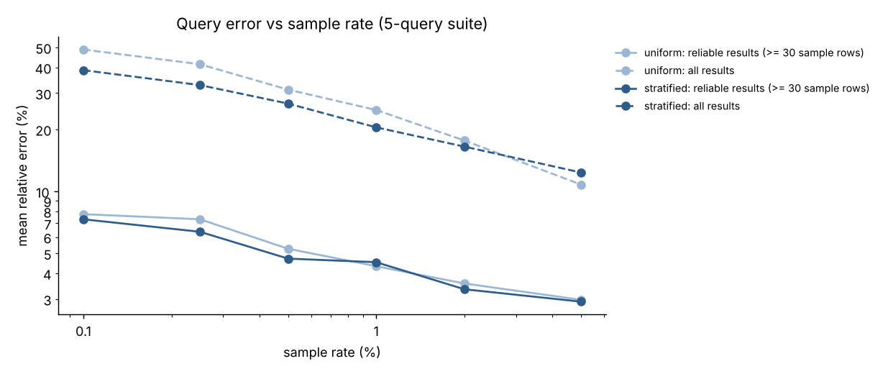

# Benchmark results

- Data: `orders_10m.csv`: 10,000,000 rows, 0.52 GB
- Machine: Linux x86_64, Python 3.13.18, chunk size 1,000,000 rows
- Stratified sampling on: region (min 2,000 rows per stratum)
- Each setting averaged over 3 sample(s) with different random seeds
- Peak process memory during the whole benchmark: **298 MB**
- Exact workload (5 queries, each a full streaming scan): **19.4s**

## Queries

- **Q1**: `SELECT AVG(price) FROM orders GROUP BY region` (exact: 4.51s)
- **Q2**: `SELECT SUM(revenue), COUNT(*) FROM orders WHERE discount > 0 GROUP BY region` (exact: 3.69s)
- **Q3**: `SELECT AVG(revenue) FROM orders WHERE category = 'C03' GROUP BY region` (exact: 4.11s)
- **Q4**: `SELECT COUNT(*), AVG(quantity) FROM orders WHERE price > 100 GROUP BY category` (exact: 3.26s)
- **Q5**: `SELECT SUM(revenue) FROM orders WHERE region = 'Oceania' AND quantity >= 3` (exact: 3.79s)

## Accuracy and speed by sample rate

- **error % (reliable)**: mean relative error over results backed by >= 30 sample rows (the engine flags the others)
- **error % (all)**: every result cell; groups missing from the sample count as 100%
- **query speedup**: exact workload time / approximate query time, sample already built
- **workload speedup**: same, but including the one-off sample build pass

| method | rate | sample rows | error % (reliable) | error % (all) | CI coverage % | build s | 5 queries s | query speedup | workload speedup |
|---|---|---|---|---|---|---|---|---|---|
| stratified | 0.001 | 17,503 | 7.31 | 38.76 | 68.80 | 5.78 | 0.067 | 288.05 | 3.31 |
| stratified | 0.0025 | 28,599 | 6.36 | 32.80 | 72.53 | 5.68 | 0.077 | 251.51 | 3.37 |
| stratified | 0.005 | 52,056 | 4.71 | 26.67 | 75.47 | 5.70 | 0.099 | 196.63 | 3.34 |
| stratified | 0.01 | 101,372 | 4.53 | 20.45 | 80.53 | 5.64 | 0.144 | 134.76 | 3.35 |
| stratified | 0.02 | 200,887 | 3.35 | 16.48 | 84.53 | 5.78 | 0.281 | 68.99 | 3.19 |
| stratified | 0.05 | 500,014 | 2.91 | 12.35 | 87.47 | 6.21 | 0.593 | 32.65 | 2.85 |
| uniform | 0.001 | 10,073 | 7.75 | 48.82 | 66.13 | 4.21 | 0.053 | 364.05 | 4.55 |
| uniform | 0.0025 | 25,101 | 7.32 | 41.42 | 73.33 | 4.21 | 0.078 | 247.53 | 4.52 |
| uniform | 0.005 | 50,127 | 5.26 | 31.18 | 76.53 | 4.10 | 0.087 | 221.99 | 4.63 |
| uniform | 0.01 | 100,090 | 4.33 | 24.82 | 82.13 | 4.11 | 0.136 | 142.24 | 4.56 |
| uniform | 0.02 | 200,232 | 3.57 | 17.65 | 86.13 | 4.15 | 0.22 | 88.22 | 4.43 |
| uniform | 0.05 | 500,269 | 2.97 | 10.79 | 87.47 | 4.28 | 0.458 | 42.30 | 4.09 |

## Mean relative error (%) by query, reliable results only (>= 30 sample rows)

Columns are sample rates.

| method | query | 0.001 | 0.0025 | 0.005 | 0.01 | 0.02 | 0.05 |
|---|---|---|---|---|---|---|---|
| stratified | Q1 | 2.43 | 1.98 | 1.64 | 1.04 | 0.81 | 0.57 |
| stratified | Q2 | 3.73 | 3.26 | 2.29 | 2.21 | 1.86 | 1.21 |
| stratified | Q3 | 4.69 | 4.63 | 4.40 | 4.11 | 2.83 | 1.92 |
| stratified | Q4 | 11.24 | 8.90 | 6.25 | 5.83 | 4.19 | 3.78 |
| stratified | Q5 | 6.85 | 6.85 | 6.85 | 6.85 | 6.85 | 4.64 |
| uniform | Q1 | 3.55 | 2.58 | 2.26 | 1.27 | 0.74 | 0.61 |
| uniform | Q2 | 7.25 | 8.23 | 4.28 | 2.81 | 2.41 | 1.51 |
| uniform | Q3 | 9.61 | 5.03 | 3.86 | 2.68 | 2.37 | 1.72 |
| uniform | Q4 | 9.20 | 7.57 | 6.29 | 5.33 | 4.39 | 3.81 |
| uniform | Q5 | nan | 37.05 | 12.30 | 17.53 | 10.28 | 5.83 |

Full numbers (median/max error, missing groups, etc.) are in `summary.csv`.

